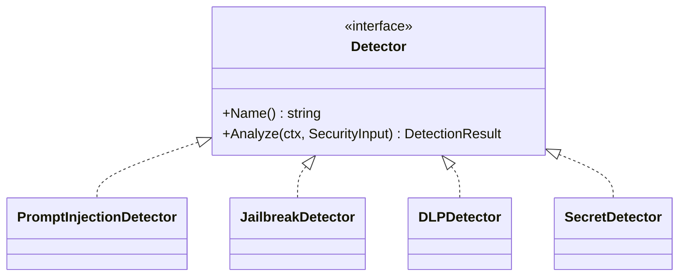

# Контракт студента 2 — Security Engine



## SecurityInput

```go
type SecurityInput struct {
    RequestID  string
    TraceID    string
    UserID     string
    SessionID  string
    SourceType SecuritySourceType
    Text       string
    Metadata   map[string]string
}
```

`Score`: 0..100. `Confidence`: 0.0..1.0. Evidence не хранит полный secret.

Reason codes должны быть стабильными. Базовые группы: `PI_*`, `JB_*`, `SP_*`, `DLP_*`, `SECRET_*`.

Security Engine не поднимает REST endpoint и не пишет напрямую в PostgreSQL.
