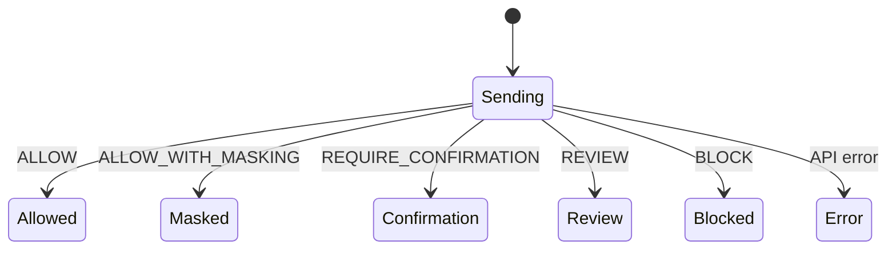

# Контракт студента 3 — Frontend

Источник истины: `docs/spec/openapi.yaml`.

Основные страницы:

`/login`, `/chat`, `/chat/:sessionId`, `/security/dashboard`, `/security/events`, `/security/events/:eventId`, `/policies`, `/documents`, `/approvals`, `/simulator`.



Frontend не вычисляет risk score и не принимает security decision самостоятельно.

Формат ошибки:

```json
{
  "error": {
    "code": "VALIDATION_ERROR",
    "message": "invalid request",
    "request_id": "uuid",
    "details": {}
  }
}
```
